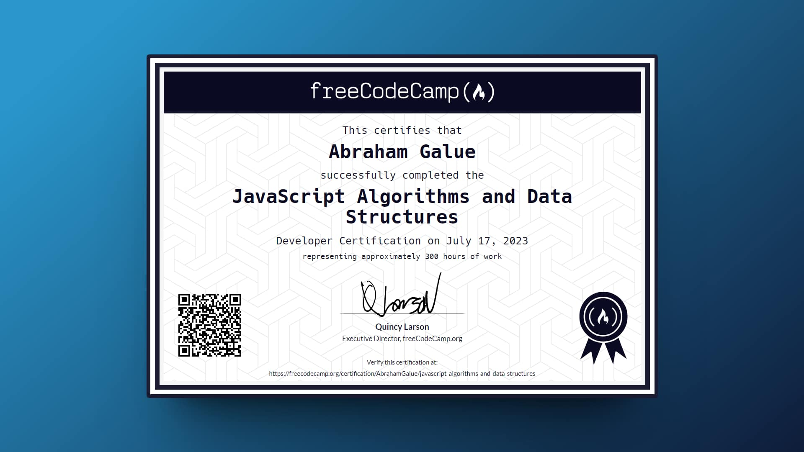

# 🔥 freeCodeCamp: JavaScript Algorithms and Data Structures

### Certificado de freeCodeCamp

> 🗝 Puedes verificar aquí la veracidad de mi [**certificado**](https://www.freecodecamp.org/certification/abrahamgalue/javascript-algorithms-and-data-structures).

## 🚀 Descripción

Este es mi repositorio de proyectos con los cuales conseguí la **certificación de freeCodeCamp** en su curso de **Algoritmos y estructuras de datos de JavaScript**. Espero que te pueda ayudar.

## 🎭 Proyectos

Los **proyectos principales** para obtener el certificado y que se incluyen en la carpeta [`js-algorithms-and-data-structures-projects`](https://github.com/abrahamgalue/js-algorithms-data-structures-certification-projects/tree/main/js-algorithms-and-data-structures-projects) son:

- Palindrome Checker
- Roman Numeral Converter
- Caesars Cipher
- Telephone Number Validator
- Cash Register
